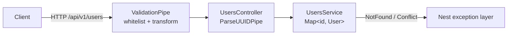

# NestJS Daily Warm-up

[](https://github.com/eshginfarzali/nestjs-daily-warmup/actions/workflows/ci.yml)
[](LICENSE)


A small NestJS REST API that I use as a warm-up for NestJS basics: modules, DTO validation, error mapping and testing. It is deliberately tiny. Data lives in memory, and there is no database or auth.

> Looking for a production-style NestJS service? See [nestjs-inventory-erp-api](https://github.com/eshginfarzali/nestjs-inventory-erp-api).

## Features

- `users` resource with full CRUD under the `/api/v1` prefix.
- **Validation** with `class-validator` / `class-transformer` through a global `ValidationPipe`. Unknown fields are rejected, usernames are trimmed and emails lower-cased.
- **Partial updates** with `PATCH`, using a DTO derived through `PartialType`.
- **HTTP semantics:** `201` on create, `204` on delete, `404` for an unknown user, `409` for a duplicate email, `400` for a malformed UUID or an invalid body.
- **Shared app setup** (`configureApp`) used by both `main.ts` and the e2e tests, so the tests run the same pipes and prefix as the real app.

## API

| Method   | Path                | Body                       | Success |
| -------- | ------------------- | -------------------------- | ------- |
| `GET`    | `/api/v1/users`     |                            | `200`   |
| `GET`    | `/api/v1/users/:id` |                            | `200`   |
| `POST`   | `/api/v1/users`     | `{ "username", "email" }`  | `201`   |
| `PATCH`  | `/api/v1/users/:id` | any of `username`, `email` | `200`   |
| `DELETE` | `/api/v1/users/:id` |                            | `204`   |

```bash
curl -X POST localhost:3000/api/v1/users \
  -H 'content-type: application/json' \
  -d '{"username":"ann","email":"ann@example.com"}'
```

## Tech stack

NestJS 11 · TypeScript (`strict`) · class-validator · Jest · Supertest · ESLint + Prettier · GitHub Actions

## Architecture



```
src/
  app.setup.ts          global prefix + ValidationPipe (shared with e2e tests)
  users/
    dto/                CreateUserDto, UpdateUserDto (PartialType)
    entities/           User
    users.controller.ts
    users.service.ts    in-memory store
test/users.e2e-spec.ts  HTTP tests against the real Nest app
```

## Getting started

Requires Node.js 20+.

```bash
npm install
cp .env.example .env    # optional: PORT (default 3000)
npm run start:dev
```

## Scripts

| Script                 | Description           |
| ---------------------- | --------------------- |
| `npm run start:dev`    | Watch mode            |
| `npm run build`        | Compile to `dist/`    |
| `npm run lint`         | ESLint, zero warnings |
| `npm run format:check` | Prettier check        |
| `npm run typecheck`    | `tsc --noEmit`        |
| `npm test`             | Unit tests            |
| `npm run test:e2e`     | HTTP end-to-end tests |

## Testing

- `src/users/users.service.spec.ts`: create, duplicate email, partial update, email ownership on update, remove, and `404` for every lookup.
- `test/users.e2e-spec.ts`: the full CRUD flow over HTTP, plus validation errors, `409` and `400` for a malformed id.

CI runs lint → format → typecheck → unit → e2e → build on every push and pull request.

## Roadmap

- [ ] Swap the in-memory map for a repository backed by PostgreSQL
- [ ] OpenAPI docs with `@nestjs/swagger`
- [ ] Pagination and filtering on `GET /users`

## License

[MIT](LICENSE) © Eshgin Farzaliyev
